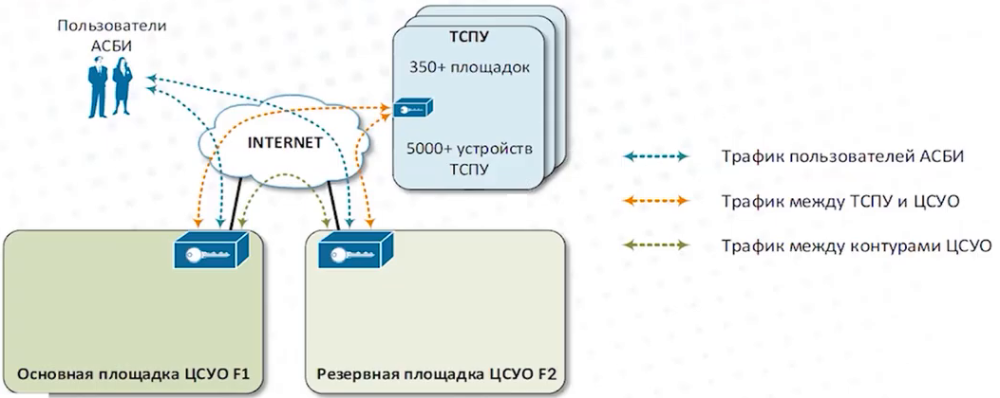

# 21. Центральная система управления (ЦСУ)

[← Оглавление](../README.md) · [← Раздел 20: Сегмент управления ТСПУ](management-segment.md)

---

## 21.1. Архитектура: две независимые площадки (основная и резервная)

Центральная система управления (ЦСУ) — это централизованная платформа, через которую осуществляется управление всеми ТСПУ, развёрнутыми по стране. ЦСУ располагается в **двух независимых ЦОДах**:

- **Основная площадка** — основной центр обработки данных;
- **Резервная площадка** — дублирующий центр, обеспечивающий отказоустойчивость.

_Основная (F1) и резервная (F2) площадки ЦСУ (на схеме — ЦСУО). Вход на каждую площадку — через криптошлюз; через интернет идут трафик между площадками ТСПУ (350+ площадок, 5000+ устройств) и обеими площадками ЦСУ, трафик пользователей АСБИ и трафик между самими площадками ЦСУ._

Обе площадки **связаны между собой** VPN-каналом через интернет, по которому осуществляется репликация данных и обеспечивается отказоустойчивость. Пользователи (инженеры эксплуатации) также попадают на ЦСУ через **шифрованные VPN-каналы**.

## 21.2. Связь с ТСПУ через VPN (криптошлюз «Континент»)

Связь между площадками ТСПУ и центральной системой управления осуществляется через **VPN**, построенный на криптошлюзах **«Континент»** (модель IPC-3000 или аналогичная).

На каждой площадке ТСПУ установлен криптошлюз, который через **публичные интернет-каналы** устанавливает VPN-соединение с более мощной моделью криптошлюза на стороне ЦСУ. Через этот VPN-канал обеспечивается:

- **Управление устройствами** — доступ к CLI фильтров, балансировщиков, байпасов;
- **Сбор данных** — протокольные логи (gRPC от SPFS), системные логи (syslog), данные мониторинга (SNMP);
- **Распространение списков** — загрузка очищенных списков на фильтры (HTTP) и на Eco Highway (BGP);
- **Обновление ПО** — централизованная загрузка прошивок на оборудование.

Каждая площадка ТСПУ связана **как с основной, так и с резервной** площадкой ЦСУ, что обеспечивает непрерывность управления при выходе из строя одной из площадок.

Криптошлюз «Континент» на площадке ТСПУ выступает **шлюзом по умолчанию** для всех устройств сегмента управления (адрес .254 в подсети управления — подробнее в [разделе 20](management-segment.md)).

## 21.3. Масштаб

На этапе развёртывания федерального проекта ЦСУ обслуживала:

| Параметр                    | Значение        |
| --------------------------- | --------------- |
| **Количество площадок ТСПУ** | ~350           |
| **Суммарное количество устройств** | ~5 000   |
| **Типы устройств**          | Фильтры, балансировщики, байпасы, SPFS, СПХД |

По официальным данным (конец 2023 года), на сетях связи было размещено более 1250 ТСПУ; по данным ФГУП «ГРЧЦ» (октябрь 2025 года) — более 1400 ТСПУ, через которые проходило 132,3 Тбит/с трафика. Что именно считается одним «ТСПУ», в этих данных не определено: скорее всего, это узел (площадка), а не отдельное устройство. Число устройств официально не публикуется.

## 21.4. Подсистемы ЦСУ: формирование списков, мониторинг, логирование, картография

ЦСУ представляет собой **многокомпонентную распределённую систему**, состоящую из нескольких подсистем, каждая из которых выполняет свою задачу:

| Подсистема                          | Назначение                                                                                  |
| ----------------------------------- | ------------------------------------------------------------------------------------------- |
| **Формирование списков фильтрации** | Сбор протокольных логов с SPFS на площадках ТСПУ, анализ, формирование очищенных списков и их распространение на фильтры (HTTP) и Eco Highway (BGP) |
| **Мониторинг**                      | Наблюдение за состоянием оборудования ТСПУ на всех площадках                                |
| **Логирование**                     | Сбор и хранение системных журналов с устройств                                              |
| **Картография**                     | Визуализация размещения оборудования и его состояния                                        |
| **Отчётность (Reports)**           | Формирование отчётов о работе системы                                                       |

Архитектура каждой подсистемы, схемы обмена данными и внутренние процессы подробно описаны в отдельном документе — **«Системная архитектура центральной системы управления»**.

Поддержкой и настройкой ЦСУ занимается **команда DevOps**. Инженеры, обслуживающие ТСПУ, являются **пользователями** ЦСУ — они используют её интерфейсы для мониторинга и управления, но не занимаются настройкой самой системы. Заливка программного обеспечения на ЦСУ также выполняется командой DevOps, тогда как заливка ПО на оборудование ТСПУ выполняется совместно инженерами площадки и разработчиками (ДЦА готовит конфигурации и новое ПО, инженеры на местах выполняют установку).

## 21.5. Новая ЦСУ для федерального проекта (замена уральской)

В ходе развития проекта АСБИ существовали **две версии** ЦСУ:

| Параметр                 | Уральская ЦСУ (пилот)                   | Федеральная ЦСУ (новая)                     |
| ------------------------ | ---------------------------------------- | -------------------------------------------- |
| **Охват**                | Уральский регион (пилотный проект)       | Вся страна (федеральный проект)              |
| **Статус**               | Тупиковая ветвь развития                 | Активная разработка                          |
| **Функционал**           | Ограниченный                             | Полный (все подсистемы)                      |
| **Подключение площадок** | Только уральские площадки                | Все площадки, включая переподключение Урала  |

ЦСУ, работавшая на уральском пилотном проекте, стала **тупиковой ветвью развития** и дальше не развивалась. Для федерального проекта создавалась **полностью новая ЦСУ**, к которой подключались все площадки ТСПУ по всей стране, включая уральские, переводимые с пилотной системы.

Новая ЦСУ разрабатывалась параллельно с развёртыванием федерального проекта. До её запуска мониторинг и управление площадками велись через существующую (уральскую) систему в ограниченном объёме.

По данным ФГУП «ГРЧЦ», информационная система Центра мониторинга и управления сетью связи общего пользования (ИС «ЦМУ ССОП») введена в эксплуатацию приказом ФГУП «ГРЧЦ» от 29.12.2021 № 343.

---

[← Оглавление](../README.md) · [← Раздел 20: Сегмент управления ТСПУ](management-segment.md) · [Раздел 22: Распознавание протоколов и двухстадийная блокировка →](protocol-blocking.md)
